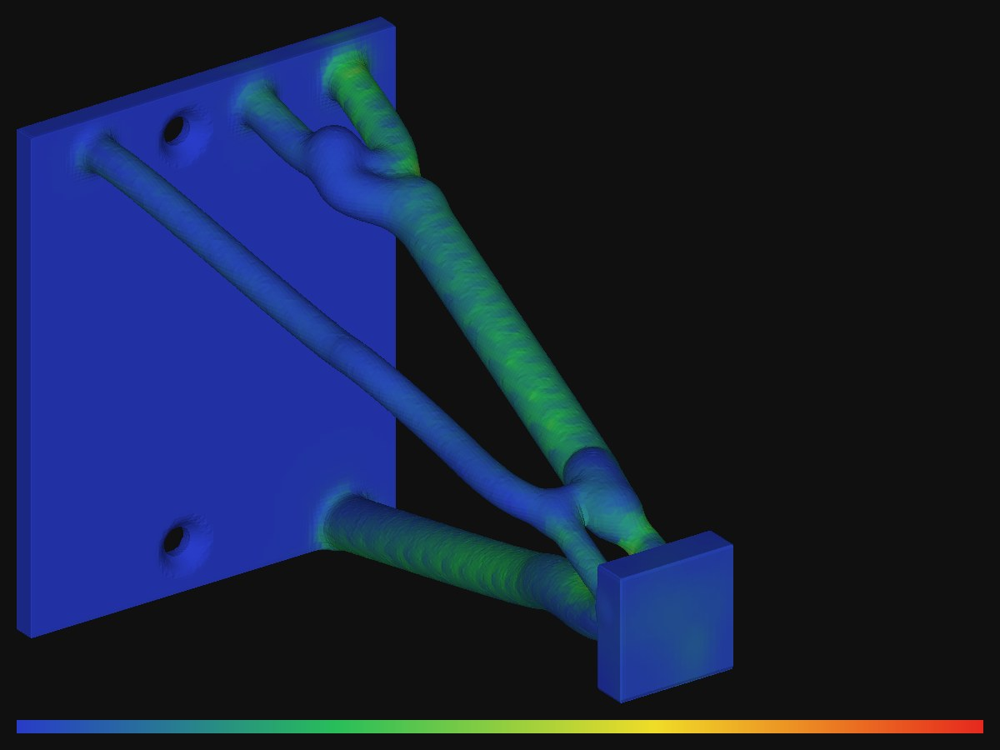
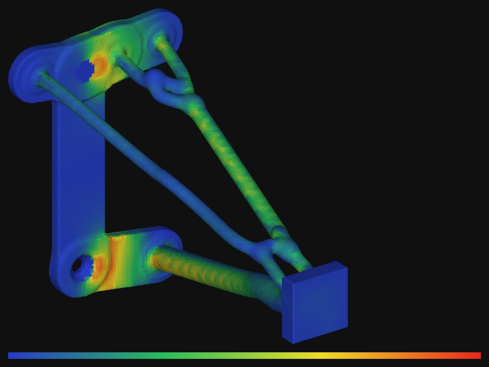

# Generative Design Engine (SolidCraft plugin)

> **Third-party project, not affiliated with SolidCraft.** This plugin is made independently by
> LudaLunizz. It is **not** made, endorsed, sponsored or supported by Tangency Labs or the
> SolidCraft maintainers, and it has no official connection to them. It only builds on their
> software: it is an add-on that runs inside SolidCraft through SolidCraft's public plugin
> interface. "SolidCraft" is their name and is used here only to say what the plugin works with.
> Questions and bugs about this plugin belong in this repository, not with the SolidCraft team.

A [SolidCraft](https://github.com/tangency-labs/solidcraft) command plugin (`craft:plugin@0.1.0`,
capability `commands@0.1`). Version 0.4: an engineering **material library** that becomes
SolidCraft's own physical material cards, a per-body **material report**, a **stress check**
for flat parts, and a **plate optimiser** that designs a lightweight plate and draws it as a sketch
and an extrude. Next to the plugin there are four command-line tools (3D stress check,
printed-part stress check, plate refine pass, beam optimiser; see below).

Version 0.6.1 is tested with **SolidCraft 0.45.0** (`tests/cli-test.sh` and `solidcraft-cli plugin
check`: no problems); 0.6.0 also with corner rounding and the `plate_refine` build script, and with 0.44.1;
0.3.x also ran on 0.43.0.

> **A design aid, not a certified analysis.** The numbers can be wrong. A qualified person must
> check them before anyone relies on them for a design, manufacturing or safety decision. The
> material values are listed below with their sources: they were checked against public data
> sheets in 0.4.0, but not against the (paywalled) standards themselves.

**User manual:** [docs/manual/Generative-Design-Engine-Manual.pdf](docs/manual/Generative-Design-Engine-Manual.pdf)
(source: [HTML](docs/manual/Generative-Design-Engine-Manual.html)), for day-to-day use: install, every
command and field, a worked example, the command-line tools, limits and troubleshooting.

## Entries

| Entry | Effect | What it does |
|---|---|---|
| `gen-design-engine.apply-material` | edit | Creates the chosen library material in the design (once, with its full engineering card) and assigns it to a body (empty = every body; scripts may pass a `bodies` list). One undo step. |
| `gen-design-engine.material-report` | read | Per body: material, volume, mass, stiffness, yield/tensile strength and the allowable stress at a safety factor. |
| `gen-design-engine.stress-check` | read | Plane-stress analysis of a flat body: fixed faces, load faces and a force in N; gives peak von Mises stress and where, the safety factor against the material's strength (pass/fail), the largest displacement, and a text heat map. |
| `gen-design-engine.optimise-plate` | edit | Topology-optimises a flat plate (cantilever or MBB half beam) for stiffness at a chosen material share, then draws the result as a sketch of closed outlines and extrudes it into a new body with the chosen library material. One undo step. Reports mass, outlines, holes and a rough load-point deflection. |
| `gen-design-engine.materials` | read | Lists the library with its values. Runs no app commands. |
| `gen-design-engine.solver-benchmark` | read | Runs the 2D SIMP optimiser on a test case and reports the work done (development tool). |

In SolidCraft: the **Plugins** group on the **Model** tab has a button per entry, labelled with
the entry name (the entries declare no ribbon slots: SolidCraft labels that group's buttons with the
slot name, which made them read "Manage" and "Inspect" up to 0.6.0). Every entry's form uses only fields SolidCraft's dialog can
draw (a test checks this). From MCP or a script: `plugin.run` with the entry name.

### Stress check

- Faces: a face name as `model.faces` lists it (`F1:-x`, `F2:bore:side:0`), its number, or a
  side of the part (`-x`, `+y`, ...); several with commas. Supports can be holes (cylinder faces
  through the thickness) or flat side faces.
- The plate's plane is across its thinnest direction unless chosen. The force's part through
  the plate is ignored, with a warning: bending out of the plane is not covered.
- Checked against beam theory: a 100 x 10 x 5 mm aluminium cantilever under 100 N gives a tip
  deflection of 1.170 mm (theory 1.17) and a peak of 121 MPa (theory 120) in SolidCraft.
- Limits: linear elastic, small deflections, rigid supports, the load spread evenly; flat parts
  of one thickness (it warns when the outline changes through the thickness or the part is
  thick); peaks at sharp inside corners grow with finer grids (it warns; round the corner, or
  judge by the 99th percentile it also reports). A design check, not a certified analysis.

### Plate optimiser

- Input: width, height, thickness, material, load case, force, material share (0.1 to 0.9), grid
  cells across the width (20 to 240), design iterations (10 to 150) and the smallest member (in
  cells). The grid is capped at 30,000 cells, and cells times iterations at 2.4 million, so a run
  stays inside SolidCraft's 1e11 fuel and 30 s (240 x 120 cells take about 80 iterations, 4.8 s;
  160 x 80 cells take 150 iterations, 3 s). The cell counts are rounded to a multiple of 4 (8 or
  16 for tall plates) so the multigrid solver can coarsen the grid; the reply and a warning give
  the height actually used. Plates that are too tall and narrow for that are refused.
- The shape comes from 2D SIMP optimisation (density filter, optimality criteria, multigrid
  solver). Cells above 0.5 density are material; only material joined to the fixed edge is kept;
  diagonal-only contacts are closed. Since 0.5 the outline is **smooth**: each boundary point is
  placed where the density crosses 0.5 between two cells (as in marching squares), the loop is
  smoothed with Taubin's method (it removes the stair steps without shrinking the part), and drawn
  as fit-point splines. Points on the plate's own edges stay pinned, so the fixed edge, the load and
  support edges stay straight lines in place; holes are closed splines. If smoothing would make two
  outlines touch, a gentler pass is used (down to the plain stair-step midpoints).
- It is checked in SolidCraft: the extruded solid has the same volume as the optimiser's own area,
  and one undo removes sketch, body and material assignment.
- **Stiffness only.** Strength, stress concentrations, buckling and manufacturability are not
  checked. Run `stress-check` on the new body before relying on it. The deflection figure is a
  rough estimate (a force on one grid node).
- The force changes the deflection estimate, not the shape: one linear material and one load.
- **Corner rounding** (`round_mm`, since 0.6): a fillet of that radius where members meet. It
  only adds material (a few per cent), so no member gets thinner; holes narrower than the fillet
  close. For a finer and rounder result the reply points to the refine pass (`plate_refine`
  below), which runs outside SolidCraft on the GPU.

Allowable stress = yield strength / safety factor, or tensile strength / safety factor for
materials without a yield value (the printed plastics). **This is not a stress analysis**: the
report says how much stress a material may take, not how much the part gets.

## Material library (`materials/library.json`)

| Id | Material | Values |
|---|---|---|
| `aluminium-6061-t6` | Aluminium 6061-T6 | specification minimums for strength (yield 240, tensile 260 MPa), ASM typical for the rest |
| `aluminium-7075-t6` | Aluminium 7075-T6 | specification minimums for strength (yield 460, tensile 540 MPa), ASM typical for the rest |
| `aluminium-5083-h111` | Aluminium 5083-H111 | specification minimums for strength up to 80 mm (yield 115, tensile 270 MPa), Aluminum Association typical for the rest |
| `steel-s235jr` | Steel S235JR | EN 10025-2 minimums, Eurocode E/nu/density |
| `steel-s355jr` | Steel S355JR | EN 10025-2 minimums, Eurocode E/nu/density |
| `stainless-304` | Stainless steel 304 | ASTM A240 minimum strengths, typical physical values |
| `stainless-316l` | Stainless steel 316L | ASTM A240 minimum strengths, typical physical values |
| `titanium-ti6al4v` | Titanium Ti-6Al-4V | ASTM B348 Grade 5 minimum strengths, typical physical values |
| `pla-printed` | PLA (3D printed, generic) | Prusament PLA data sheet (printed specimens) |
| `petg-printed` | PETG (3D printed, generic) | Prusament PETG data sheet (printed specimens) |
| `abs-printed` | ABS (3D printed, generic) | Bambu Lab ABS data sheet (annealed specimens) |
| `asa-printed` | ASA (3D printed, Bambu Lab) | Bambu Lab ASA data sheet V3.0 (annealed specimens) |
| `paht-cf-printed` | PAHT-CF (3D printed, Bambu Lab) | Bambu Lab PAHT-CF data sheet V3.0 (annealed specimens, dry) |
| `pa12-sls` | Nylon PA12 (SLS printed, generic) | EOS PA 2200 data sheet (laser sintered) |

Every property names its source in the card; SolidCraft shows them as "source review required".
**Checked on 19 Nov 2026 (0.4.0):** the metal values against public data sheets (ASM data via
reseller copies, mill data sheets, Eurocode summaries; the standards themselves are paywalled), and
the four plastics replaced by manufacturer data sheets of printed specimens. One correction came
out of it (7075 thermal expansion 23.6, not 23.4). Things to know:

- 6061-T6 and 7075-T6 use guaranteed **specification minimums** for yield and tensile strength
  (since 0.4.1; 0.4.0 had the ASM typical values 276 / 310 and 503 / 572 MPa, which the Aluminum
  Association marks not for design). 6061-T6: 240 / 260 MPa, the extrusion and bar minimum (sheet
  and plate guarantee 240 / 290). 7075-T6: 460 / 540 MPa, plate 6.3-12.5 mm unclad (ASTM
  B209M-14 table 3, Aluminum Association table 11.1, EN 485-2 / 755-2). Thicker plate, clad sheet
  and other forms differ; check the supplier's certificate. No shear strength is listed, because no
  specification guarantees one.
- S355JR tensile is the EN 10025-2 product minimum (470 MPa); Eurocode 3 designs with 490 MPa.
  Yield drops for sections thicker than 16 mm.
- 304 and 316L follow the ASTM/ASM side (density 8000, E 193 GPa); EN 1.4301/1.4404 data sheets
  use slightly different physical values. For 316L, Poisson ratio, conductivity and expansion are
  widely quoted typical values that were not on the ASM sheet.
- Printed plastics are **one brand each** and the Poisson ratios are generic estimates. The ABS
  sheet's specimens were annealed (stronger than ordinary parts), so its in-plane modulus
  (3.8 GPa) is not used; the library has the across-layers 2.96 GPa. Across the layers (Z) the
  datasheets give lower strengths (PLA 38, PETG 30, ABS 32, PA12 42 MPa); the library holds the
  in-plane values, so a part loaded across its layers is weaker than the card says.
- 5083-H111 uses the O/H111 minimums that hold for any thickness up to 80 mm (115 / 270 MPa);
  thin sheet up to 6.3 mm guarantees 125 / 275, plate over 80 mm less.
- PAHT-CF and ASA are Bambu Lab's V3.0 sheets (annealed specimens). Across the layers they give
  PAHT-CF 47 MPa (half of in-plane 92) and ASA 31 MPa. PAHT-CF is the dry value: the sheet has
  no conditioned figures, and nylon that has taken up moisture is weaker.

To add or change a material: edit `materials/library.json`, run `./build.sh` (it regenerates
`plugin.json`, runs every check and packages the zip), then `tests/cli-test.sh`.

A design material with the same name as a library material but other values is never overwritten:
`apply-material` refuses and says so. The report leaves out strengths when a body's material has
a library name but a different density.

## Build, test, install

```bash
rustup target add wasm32-unknown-unknown
cargo install wasm-tools --locked
./build.sh              # tests, clippy -D warnings, wasm build, component, dist/*.zip + .sha256
tests/cli-test.sh       # end to end in the installed SolidCraft (headless solidcraft-cli)
```

Install: **Preferences › Plugins › Install plugin…** and pick `dist/gen-design-engine-<version>.zip`,
or `plugin.install {"path": ".../gen-design-engine-<version>.zip", "replace": true}`.
The plugin needs no command groups, folders, clock or network.

## Command-line tools (outside SolidCraft)

These run natively (no plugin limits on time or memory) and are built with
`cargo build --release --bins`. They are experimental.

| Tool | What it does |
|---|---|
| `stress3d` | 3D voxel stress check of an STL part: majority-vote voxelisation, multigrid-preconditioned CG solve (`--jacobi` for the plain Jacobi solver), von Mises heat maps (PNG) and a report (`report.json`) with the safety factor against a library material. |
| `stress3d_printed` | The same for a **3D-printed** part: solid walls and top/bottom skins around a lighter infill core, with layers along z. Infill stiffness is `infill^exp` (exp 1 = upper bound, exp 2 = lower bound). |
| `plate_refine` | The plate optimiser's **refine pass**: the same optimisation as `optimise-plate` at up to 800 cells across, on the GPU (busy share capped, default 80 %), with members at least `min_member` mm wide and the inside corners rounded (`round`, mm). Writes a script that builds the body in SolidCraft. |
| `eso3d` | 3D **"start with a pyramid and take out what is not needed"** for a wall bracket: a solid frustum on the wall, the voxels with the least stress removed round by round (hard-kill ESO on the 3D solver) with a minimum member size, until a safety factor or a target share is reached. Writes the voxel STL and a smooth STL (blurred arms, exact wall plate and tip pad, volume kept), optionally with countersunk screw holes (`holes=y:z,...`: 4.5 mm, 8.4 mm at 90°). `check=FILE.stl` stress-checks any STL with the same loads. |
| `beam_opt` | Lightest plate-truss for a long cantilever beam: SIMP topology optimisation with a min-member filter, then strut and sideways (lateral-torsional) buckling checks. |

The 3D tools use a geometric multigrid preconditioner (`src/mg3d.rs`): Galerkin coarse matrices per
coarse cell, trilinear transfers, damped Jacobi smoothing with the damping set from the largest
eigenvalue of each level, a dense solve at the bottom. It gives the same answers as plain
Jacobi-preconditioned CG (the tests compare them) in far fewer steps. On the wall foot (150,000
voxels of 1.5 mm, PETG) the CG steps drop from about 1,850 to about 90 and the run from 137 s to 39 s;
at 2.5 mm voxels from 14.5 s to 6 s; the printed-part tool at 2 mm from 47 s to 24 s. Grids small
enough for a plain solve (a few thousand free DOFs) skip it, and a grid whose first coarse level
would need more than 4 GB falls back to Jacobi with a warning.

**Refine pass (`plate_refine`).** After a plate from `optimise-plate`, this redoes it finer and
rounder outside SolidCraft's limits. Build it with the GPU feature, run it, then run the script it
writes in the open design (`solidcraft-cli run refine.json`, or the MCP `batch {"path": ...}`):

```bash
cargo build --release --features gpu --bin plate_refine
target/release/plate_refine width=200 height=100 thickness=10 material=petg-printed share=0.4 \
  cells=480 min_member=3 round=4 name="Refined plate" --out refine.json
```

The refine pass runs until the design has settled (each cell changes by less than 1 % in a step;
the limit is 3,000 iterations): the 200 x 100 mm PETG plate at 480 x 240 cells settled after
1,340 iterations in about 3 minutes (104.4 g; at 300 iterations it was 104.4 g too).

The GPU limit (`gpu_max`, default 80) counts the whole GPU, the desktop included. This tool's own
share starts at the limit minus 30 points (the desktop alone reaches about 50-60 % in short
bursts); after every solver step it pauses for a share of the step's time, and where the kernel
reports the GPU's busy share (amdgpu `gpu_busy_percent`) the pauses grow while the total is over
the limit, and the next step waits while the total is within 10 points of it. Measured on an
RX 5700 XT with the desktop running (busy share sampled 10 times a second over the 3-minute run):
the 1-second average never above 67 %; 6 single readings of 1,653 (0.4 %) touched 81-84 %, where a
desktop redraw and a solver step fell together. The desktop alone, over 4 minutes: at most 61 %.

Rounding is a morphological closing (grow by the fillet radius,
then shrink by it) on an exact distance transform (Felzenszwalb and Huttenlocher), so it only adds
material: no member gets thinner, holes narrower than the fillet close.

Usage is in the header comment of each file in `src/bin/`. Example:

```bash
cargo run --release --bin stress3d -- part.stl --material aluminium-6061-t6 \
  --fix zmin --pin z,50,30,4 --case pull:0,0,-200 --voxel 1.5 --out out/
```

The optional **GPU solver** (wgpu, f64 multigrid-preconditioned CG) speeds up `beam_opt`
(`gpu=1`) and needs a GPU with 64-bit float support:
`cargo build --release --features gpu --bins`. Without the feature, or without a suitable GPU,
the CPU solver is used. The plugin's WebAssembly build never uses it.

A design from `beam_opt` is a starting point: the plate-truss weight is limited by strut and
lateral-torsional buckling, not by stiffness or strength, and none of this replaces a proper
structural calculation.

## Run gallery: the wall bracket

What the 3D tools produce, from the wall-bracket runs of `eso3d` (50 N down + 15 N sideways at the tip,
PETG, safety factor 4): run 6 (round bars, 94 g) and run 8 (sized bars on a slim frame, 58 g). Colours are
von Mises stress, scaled to each picture's own peak.

| Run 6, 73.8 cm³, SF 7.6 / 15.0 | Run 8, 45.6 cm³, SF 4.1 / 6.8 |
|---|---|
|  |  |

All views of runs 6 to 9, the numbers of runs 1 to 9 and the raw reports are in
[docs/runs](docs/runs/README.md). Run 10 (the wall pushing back) is still computing; its first numbers are in the table.

## Hardening notes

- Inputs are hostile: unknown fields, non-objects, bad numbers, empty/duplicate/oversized body
  names are refused with `invalid-input` before any edit. No unwrap/expect/panic/indexing in
  non-test code (clippy-denied); `unsafe` only in the generated WIT bindings.
- Host errors pass through unchanged, so SolidCraft rolls the transaction back.
- Cancellation is checked before each edit.
- Limits: 2e9 fuel, 64 MiB, 15 s: inside SolidCraft's default ceilings, so no extra approval.
- The component imports only `craft:plugin` interfaces (no WASI); `build.sh` refuses anything else.

## SolidCraft 0.42 notes

- `material.list` and `material.inspect` only read, but 0.42 does not mark them read-only, so a
  read entry may not call them. The report and the stress check therefore take strengths from the
  library (matched by name, checked by density).
- The plugin dialog draws numbers, whole numbers, checkboxes, dropdowns and text only; a list
  field (such as `bodies`) switches Run off. Hence the `body` text field.
- 0.42's `plugin.install` takes only `path`, `replace` and `dry_run`.

## History

0.1.0 (not working): the manifest granted a non-existent command and asked for more than the
host allows; `plugin.wasm` was SolidCraft's sample box component, not this code; `optimize` and
`analyze` returned invented numbers. It stays in the git history.

## Credits

The outline smoothing is written for this plugin from the published methods, not copied from any
program:

- G. Taubin, "A signal processing approach to fair surface design", SIGGRAPH 1995 (the λ|μ
  smoothing used here, λ = 0.5, μ = -0.53).
- M. Desbrun, M. Meyer, P. Schröder, A. H. Barr, "Implicit fairing of irregular meshes using
  diffusion and curvature flow", SIGGRAPH 1999 (the Laplacian smoothing that Blender's Laplacian
  Smooth modifier is based on).

Thanks to the Blender project, whose smoothing tools were the model for this step. Blender's code
is GPL, so none of it is used here; this plugin stays MIT OR Apache-2.0.

## License

Dual-licensed, like SolidCraft itself: **MIT OR Apache-2.0**, at your option. See
[`LICENSE-MIT`](LICENSE-MIT) and [`LICENSE-APACHE`](LICENSE-APACHE). Copyright (c) 2026 LudaLunizz.
The software is provided "as is", without warranty of any kind; see both licences.
See [SECURITY.md](SECURITY.md) to report a vulnerability and [CONTRIBUTING.md](CONTRIBUTING.md) to contribute.
